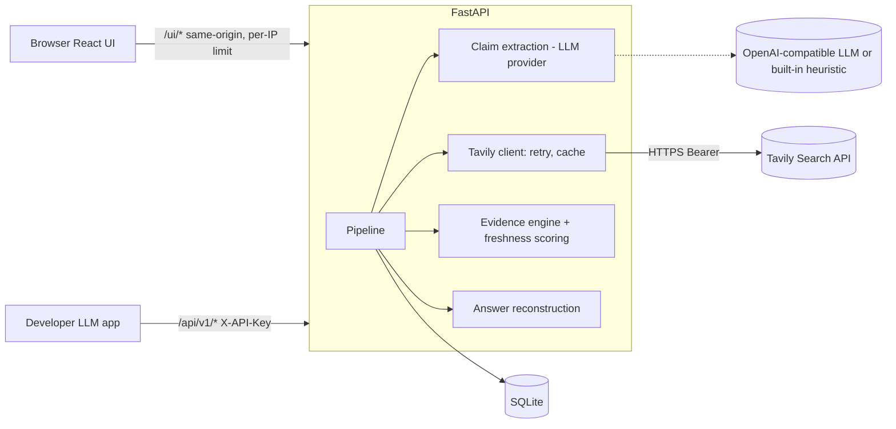

# Architecture

Flow per claim: extract -> classify volatility -> up to 2 targeted queries -> dedupe + authority tagging -> sanitize
excerpts -> judge stances from retrieved evidence only -> deterministic status decision -> correction validated against
excerpts -> cited rewrite. Two route sets share one handler: `/api/v1` (API key) and `/ui` (same-origin, no secret in browser).
Deliberate choices: SQLite via parameterized queries (PostgreSQL is not implemented); synchronous verification (no job queue);
in-memory rate limiter and cache (single process).
